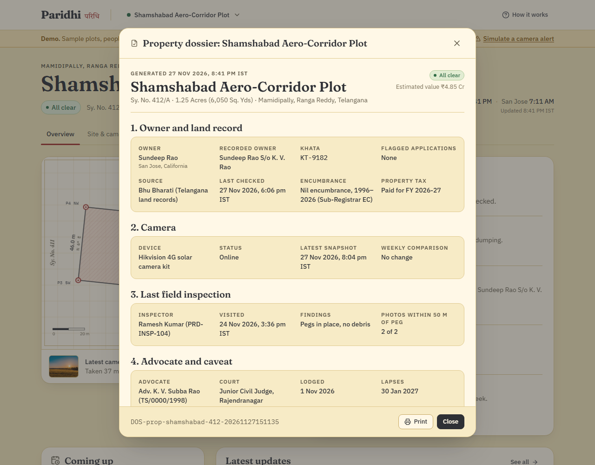
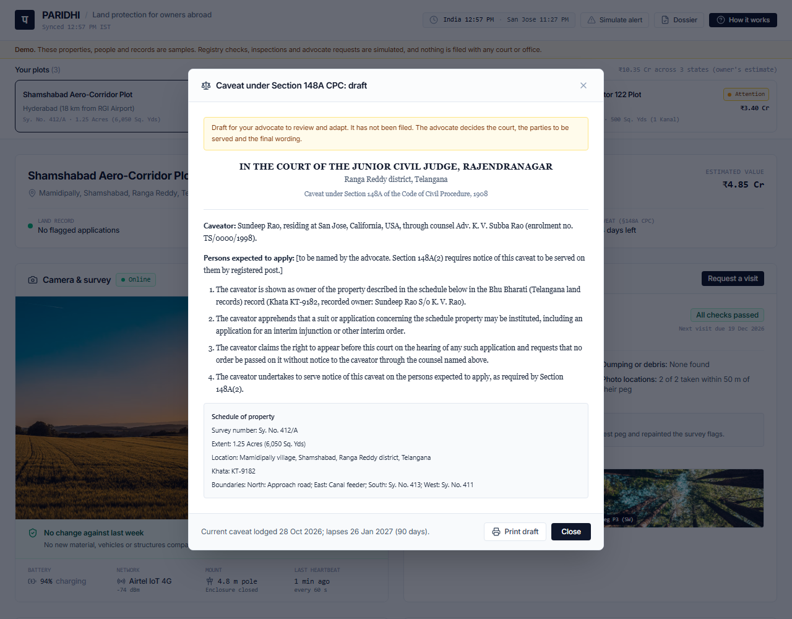

# Paridhi (परिधि)

**Remote protection for vacant land in India owned by people living abroad.**

Paridhi combines a solar 4G camera on the plot, a monthly visit by a local field inspector, regular checks of the state
land record, and a retained local advocate. The owner sees all of it in one dashboard.

> **Status: early product.** The dashboard, API, Postgres storage, owner sign-in, signed evidence records and tests
> are real code. Camera, land records and court work is still simulated, and without a database the app runs as an
> open demo on sample data. See [what is real and what is simulated](#what-is-real-and-what-is-simulated).


## The problem

Vacant plots usually have no mains power, no internet and no compound wall, so ordinary home cameras don't work
there. Encroachment tends to start small: dumped bricks or gravel, a boundary peg moved a foot, a tin shed. Fraud can
also start on paper, with a mutation application at the revenue office. Owners living abroad often hear about it late,
and land disputes in Indian civil courts can take many years to resolve.

## How it works

| Layer | What happens |
| :--- | :--- |
| **Solar 4G camera** | An off-the-shelf solar 4G camera on a 4.5 m pole uploads scheduled snapshots and motion clips. A weekly comparison flags new material, vehicles or structures. See [docs/HARDWARE_EDGE_SPEC.md](docs/HARDWARE_EDGE_SPEC.md). |
| **Field inspection** | A local inspector visits monthly, checks every corner peg and talks to neighbours. Photo GPS positions are checked against the surveyed pegs (within 50 m). Owners can request an extra visit. |
| **Land record watch** | Staff check the state portal (Bhu Bharati in Telangana, Bhoomi and E-Swathu in Karnataka, Jamabandi in Punjab) for mutation applications the owner did not start. See [docs/REGISTRY_RADAR_SPEC.md](docs/REGISTRY_RADAR_SPEC.md). |
| **Advocate and caveat** | A retained advocate can lodge a caveat under Section 148A CPC in the civil court and file objections to a mutation with the revenue office. A caveat lasts 90 days and must be renewed. |

Proposed pricing is ₹4,999 a month per plot. The unit economics and what they leave out are in
[docs/FOUNDER_INVESTOR_MEMO.md](docs/FOUNDER_INVESTOR_MEMO.md).

## What is real and what is simulated

| Area | In this repository |
| :--- | :--- |
| Dashboard | Real. Every status, badge and checklist is computed from the data; nothing is hard-coded as "clear". |
| API | Real Express API with input validation, JSON errors and tests. |
| Data | Real when `DATABASE_URL` is set: Postgres (Supabase), with every query scoped to the signed-in owner and evidence stored append-only. Without it, an open demo on three sample plots held in memory. |
| Sign-in | Real when a database is set: Supabase Auth with email and password or an emailed sign-in link. Paridhi creates owner accounts; there is no public sign-up. |
| Camera | **Simulated.** `services/device-simulator/device_simulator.py` plays the part of a camera and reports incidents with a device token. |
| Land record checks | **Simulated.** "Check now" re-reads the stored record. It never clears an existing flag. |
| Inspections and caveat renewals | Recorded as requests. Nobody is dispatched and nothing is filed. |
| Evidence integrity | Real. Incidents and dossiers are hashed (SHA-256) and signed (Ed25519) by the server, and can be verified with the public key. See [docs/BSA2023_EVIDENCE_SPEC.md](docs/BSA2023_EVIDENCE_SPEC.md). |

The plan for closing these gaps is in [docs/ROADMAP.md](docs/ROADMAP.md).

## Running it locally

Requires Node.js 22 or later.

```bash
npm install
npm test          # API, database, sign-in, domain and evidence tests
npm run build     # build the web app into web/dist
npm start         # API and web app on http://localhost:4000
```

With no `.env`, this is the open demo. For development with hot reload, run these in two terminals and open
http://localhost:3000:

```bash
npm run dev:api
npm run dev:web
```

### Using the database and sign-in

1. Create a Supabase project and apply `supabase/migrations/` (Supabase CLI: `supabase db push`, or paste the SQL
   into the SQL editor).
2. In Supabase Authentication, turn off **Allow new users to sign up**, set the **Site URL** to where the app runs
   (and add `http://localhost:4000` to the redirect URLs for local use), and add each owner under **Users**.
3. Copy `.env.example` to `.env` and fill in `DATABASE_URL` (the transaction pooler string from **Connect**),
   `SUPABASE_URL` and `SUPABASE_PUBLISHABLE_KEY`.
4. Optionally load the sample plots for an owner to try it out:

   ```bash
   npm run db:seed -- --email owner@example.com
   ```

5. `npm run build && npm start`, open http://localhost:4000 and sign in.

The server refuses to start with a database but no sign-in settings, so real data is never served openly.

### Configuration

Copy `.env.example` to `.env` (gitignored) or set these in your hosting provider.

| Variable | Purpose |
| :--- | :--- |
| `DATABASE_URL` | Postgres connection string. Set it to store data in the database and require owner sign-in. Leave it out for the open demo. |
| `SUPABASE_URL`, `SUPABASE_PUBLISHABLE_KEY` | Supabase project URL and publishable key, used for sign-in. Required with `DATABASE_URL`. Both are public values. |
| `SUPABASE_JWT_SECRET` | Only for projects still on the legacy shared JWT secret. New projects use the public key set instead. |
| `DATABASE_CA_CERT` | Optional CA certificate (PEM) so the database certificate is verified. |
| `PARIDHI_DEVICE_TOKEN` | Shared secret cameras send as `Authorization: Bearer …`. Device ingest is disabled without it. |
| `PARIDHI_SIGNING_KEY` | Ed25519 private key for signing evidence. Generate one with `npm run keygen`. Without it the server makes a throwaway key, and signatures stop verifying after a restart. |
| `PORT` | Port for `npm start`. Defaults to 4000. |

### Simulating a camera incident

```bash
export PARIDHI_DEVICE_TOKEN=pick-a-long-random-string
npm start
# in another terminal, with the same token exported:
python services/device-simulator/device_simulator.py --property prop-shamshabad-412
```

The plot turns to "Needs attention" and the incident appears in the activity log and the signed dossier.

## API

With a database configured, every route except `/api/health`, `/api/evidence/public-key` and device incidents needs
`Authorization: Bearer <Supabase access token>`, and only returns the signed-in owner's plots. Another owner's plot
returns 404.

| Method and path | Description |
| :--- | :--- |
| `GET /api/health` | Demo or database mode, sign-in settings for the web app, device ingest, signing key id. |
| `GET /api/properties` | The owner's plots. |
| `GET /api/properties/:id` | One plot. |
| `POST /api/properties/:id/inspection-requests` | Ask for an extra inspection. Body: `{ "notes": "…" }` (up to 500 characters). |
| `POST /api/properties/:id/registry-checks` | Record a land record check. Existing flags are kept. |
| `POST /api/properties/:id/caveat-renewals` | Ask the advocate to renew (or file) the caveat. |
| `POST /api/properties/:id/incidents` | Camera incident. Requires the device token. Body: `type`, `description`, optional `snapshotSha256`, `capturedAt`. |
| `GET /api/properties/:id/evidence` | Signed evidence records and their Merkle root. |
| `GET /api/properties/:id/dossier` | A signed snapshot of everything on file for the plot. |
| `GET /api/evidence/public-key` | Public key for verifying signatures. |
| `POST /api/demo/properties/:id/simulate-alert` | Demo only. |
| `POST /api/demo/properties/:id/reset` | Demo only. |

## Deploying to Vercel

Import the repository with the project root as the root directory. `vercel.json` builds the web app into `web/dist`
and routes `/api/*` to the Express app through `api/index.ts`.

Set `DATABASE_URL`, `SUPABASE_URL`, `SUPABASE_PUBLISHABLE_KEY`, `PARIDHI_SIGNING_KEY` and `PARIDHI_DEVICE_TOKEN` in the
Vercel project's environment variables. Use Supabase's transaction pooler connection string, which suits serverless
functions. Without `DATABASE_URL` the deployment is the open demo, and because demo data lives in memory, each
serverless instance has its own copy and changes may not stick between requests.

## Project layout

```
shared/               Types and domain rules used by both the API and the web app
services/             Express API, storage (memory and Postgres), sign-in checks, evidence signing,
                      tests, seed and key scripts, device simulator
web/                  React + Vite + Tailwind dashboard and sign-in screen
api/                  Vercel serverless entry
supabase/migrations/  Database schema
docs/                 Hardware, registry, evidence, roadmap and business notes
```

## Legal notes

Paridhi is not a law firm and the app is not legal advice. Points to confirm with a practising advocate before
launch:

- A caveat under Section 148A CPC is lodged in a civil court. The court must give the caveator notice before passing
  an order on an application, but it does not stop orders being made. It lapses after 90 days, and notice of it must be
  served on the person expected to apply.
- Objections to a mutation before the Tahsildar fall under each state's land records law, not the CPC.
- Signed records show data has not changed since it was signed. In court, electronic records need a certificate under
  Section 63 of the Bharatiya Sakshya Adhiniyam, 2023, signed by the responsible person, and admissibility is for the
  court.
- Camera footage covering neighbouring land or roads involves personal data, so it needs a policy under the Digital
  Personal Data Protection Act, 2023.
- The wording of the warning sign on site should be approved by the local advocate.

## More screenshots

| Signed dossier | Caveat draft |
| :---: | :---: |
|  |  |

## License

[MIT](LICENSE)
