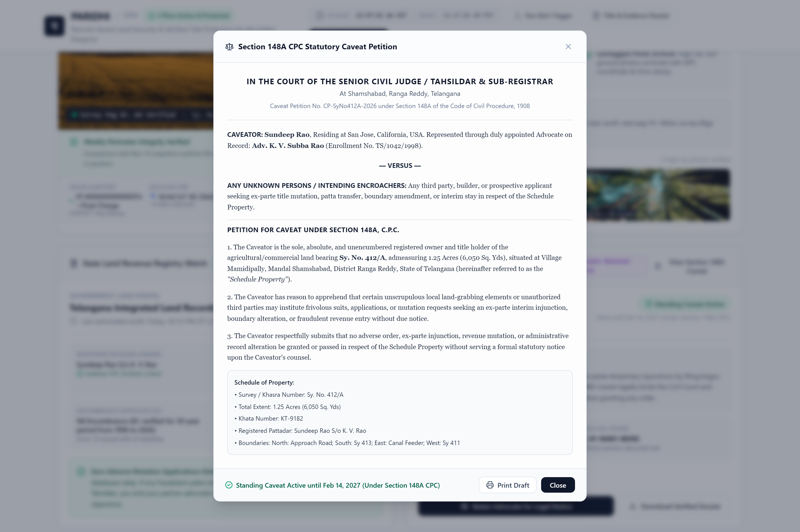

<div align="center">

# PARIDHI (परिधि)
### Remote Vacant Land Protection & Verified Title Defense for the Indian Diaspora

**The Hybrid Edge Hardware, Human Field Audit & Revenue Registry Platform for NRI Landowners**

[](https://www.typescriptlang.org/)
[](https://react.dev/)
[](https://tailwindcss.com/)
[](https://nodejs.org/)
[](https://indiacode.nic.in)
[](services/test/runTests.ts)
[](LICENSE)

*Built to solve the real problem: "How can NRIs living 8,000 miles away protect vacant plots in India from encroachment, material dumping, and fraudulent title mutations?"*

</div>

---

## 1. Executive Summary: The $1.2 Trillion Diaspora Land Crisis

Non-Resident Indians (NRIs) hold over **$1.2 Trillion** in ancestral and investment property across India—over 68% in vacant plotted land across emerging metro growth corridors:
- **Hyderabad:** Shamshabad Aero-Corridor, Gachibowli, Tellapur, Adibatla
- **Bengaluru:** Devanahalli Airport Corridor, Sarjapur, Whitefield, Hennur
- **Mohali / Chandigarh Tri-City:** GMADA Aerocity, Sector 120-125
- **Delhi-NCR:** Gurgaon Southern Peripheral Road, Yamuna Expressway, Noida Extension
- **Pune & Ahmedabad:** Hinjewadi Phase 3, Dholera SIR, Sanand

Residing 8,000 miles away in North America, Europe, the Middle East, or Australia with a 10 to 13-hour timezone difference creates an acute vulnerability that conventional consumer technology completely fails to solve.

### The 3 Real Vulnerabilities of Vacant Plots

1. **The Infrastructure Void:** Vacant plots have zero mains electricity (no 230V connection), zero broadband Wi-Fi, and no compound walls. Standard consumer cameras (Ring, Nest, Arlo, CP Plus) require grid power and local Wi-Fi, making them completely non-viable.
2. **The Encroachment Playbook:** Land grabbers don't storm in overnight. They dump construction debris (red clay bricks, sand piles, gravel), quietly shift concrete boundary stones by 1 to 2 feet, or erect temporary religious shrines or tin sheds. If unchallenged for even a few weeks, local police declare it a "civil boundary dispute". Under the Specific Relief Act, 1963, civil title litigation in India takes an average of **15 to 22 years**.
3. **The Revenue Office Fraud (Patta Mutation):** Corrupt local brokers collude with village revenue officers (Patwaris / VROs) to submit bogus mutation applications or duplicate patta claims in state land records while the NRI owner is overseas. By the time the diaspora owner discovers it years later during an in-person trip, the land has been sold twice to "bona fide purchasers".

---

## 2. The PARIDHI Hybrid Model: Tech + Trust Operations

Hardware alone cannot save land in India—local revenue officials and encroachers do not care about a camera if there is no physical or legal enforcement. Software alone cannot see the physical ground. 

PARIDHI unites **4 complementary defensive layers**:

```
┌────────────────────────────────────────────────────────────────────────┐
│                        PARIDHI DEFENSE ARCHITECTURE                    │
├────────────────────────────────────────────────────────────────────────┤
│  LAYER 1: 4G SOLAR COTS EDGE POD                                       │
│  • Off-the-shelf 4G Solar PTZ Camera (Hikvision, Dahua, Reolink)       │
│  • 25W Monocrystalline Solar Panel + 20Ah LiFePO4 (7-Day Backup)       │
│  • Airtel / Jio Dual IoT eSIM with Daily High-Res Perimeter Snapshots   │
├────────────────────────────────────────────────────────────────────────┤
│  LAYER 2: WEEKLY VISUAL TIMELAPSE & COMPUTER VISION                   │
│  • Scheduled daily captures (08:00 & 16:00 IST) + PIR motion events    │
│  • Automated weekly delta comparison (detects dumped bricks, gravel,   │
│    shifted boundary stones, or newly erected tin fencing)              │
├────────────────────────────────────────────────────────────────────────┤
│  LAYER 3: MONTHLY VERIFIED PHYSICAL FIELD INSPECTIONS                  │
│  • Background-checked local field inspectors visit plot monthly        │
│  • Verifies all 4 corner boundary stones & paints yellow survey flags  │
│  • Interviews adjacent landowners & caretaker to detect hidden claims  │
│  • Signs geotagged 360° photo report directly to owner dashboard       │
│  • One-click on-demand inspection dispatched within 48 hours           │
├────────────────────────────────────────────────────────────────────────┤
│  LAYER 4: REVENUE REGISTRY WATCH & ON-CALL ADVOCATE RETAINER          │
│  • Daily automated tracking of official state revenue portals:         │
│    - Telangana Dharani (Integrated Land Records Management System)     │
│    - Karnataka Bhoomi / Kaveri Online Services                         │
│    - Punjab Jamabandi / GMADA Estate Office                            │
│  • Alerts owner within 24h if any unauthorized mutation is submitted   │
│  • Empanelled High Court Advocates file Section 148A CPC Caveat       │
│    Petitions to legally block ex-parte orders before the Tahsildar    │
└────────────────────────────────────────────────────────────────────────┘
```

---

## 3. Hardware Ecosystem & Engineering Specifications

### 3.1 On-Site Pre-Requisites (Vacant Land)
- **Utilities Required:** **Zero.** Requires neither mains electricity nor broadband Wi-Fi.
- **Physical Pre-Requisite:** Standard plot access to install a single **15-foot (4.5m) heavy-gauge Galvanized Iron (GI) pole** anchored into a 2ft × 2ft concrete footing.

### 3.2 Supported Hardware Platforms
Paridhi runs on standard, commercially proven, off-the-shelf (COTS) 4G Solar security cameras readily available worldwide and across India:
1. **Hikvision 4G Solar PTZ (Model DS-2XS6A25G0):** 4MP/2K resolution, pan-tilt-zoom, 30W solar panel, 20Ah battery.
2. **CP Plus Orange+ Solar 4G Series:** Outdoor IP66 weatherproof, color night vision, two-way audio.
3. **Reolink Argus Eco 4G / Go PT Plus:** Low-power PIR-triggered autonomous pod.
4. **Paridhi Turnkey Modular Pod:** Pre-assembled industrial kit shipped directly to the plot with pre-configured dual-carrier IoT SIMs.

| Subsystem Component | Specification & Engineering Choice | Purpose & Reliability Rationale |
| :--- | :--- | :--- |
| **Optical Sensor** | 4MP / 2K CMOS Sensor with 110° Wide-Angle Lens | Captures clear perimeter demarcations, vehicle license plates, and boundary stones up to 45 meters. |
| **Night Illumination** | Dual IR LEDs (30m) + Warm White LED Spotlights | Provides crisp black-and-white night vision or color video when motion is detected. |
| **Solar Power Array** | 25W–30W Monocrystalline A-Grade PV Panel (IP67) | High-efficiency solar conversion even on overcast monsoon days. |
| **Battery Storage** | 12.8V 20Ah Lithium Iron Phosphate (LiFePO4) Pack | Rated for 3,500+ charge cycles. Thermal runaway safe up to 60°C ambient (peak Indian heatwaves). |
| **Cellular Connectivity** | Dual-Network IoT eSIM / Nano-SIM (Airtel & Jio 4G) | Automatic carrier failover with static IP. Consumes <1.5GB/month on smart duty cycling. |
| **Physical Mounting** | 3-inch Galvanized Iron (GI) Pole (4.5m / 15ft height) | Elevation prevents ground reach; galvanized zinc coating prevents rust over 15+ years. |

### 3.3 Hardware Utilization: Efficiency & Reliability
- **Smart Duty-Cycling:** The camera does not stream 24/7 video (which would drain batteries and consume expensive bandwidth). Instead, it runs on an ultra-low-power quiescent sleep profile (0.25W), waking up on dual events:
  1. **Daily Scheduled Snapshots:** Captures crisp high-resolution perimeter frames at 08:00 and 16:00 IST daily.
  2. **PIR Motion Events:** Any human or vehicular movement within 15 meters wakes the camera in under 500 milliseconds, recording a 15-second 1080p clip uploaded immediately to cloud storage.
- **Monsoon Energy Autonomy:** The 256 Wh usable LiFePO4 battery pack over a 25 Wh/day average duty-cycle consumption delivers **7 to 10 continuous days of autonomous operation** under total monsoon cloud cover.
- **Weekly Visual Timelapse:** Cloud computer vision performs week-over-week pixel delta analysis comparing current perimeter snapshots against baseline reference images. It immediately flags:
  - Dumping of red bricks, stone gravel, or sand mounds.
  - Movement or removal of corner boundary stones.
  - Parking of heavy earthmoving equipment (JCBs, tractors).
  - Unauthorized erection of temporary fencing, tin sheets, or boundary pegs.

### 3.4 6-Layer Real-World Theft-Proof & Anti-Tamper System

```
                         [ 4.5m Elevation Pole Top ]
                                     │
                    ┌────────────────┴────────────────┐
                    │  2K 4G Solar PTZ Camera Unit    │
                    │  Internal concealed wiring      │
                    └────────────────┬────────────────┘
                                     │
               ══════════════════════╪══════════════════════
               [ 360° Rotating Smooth Anti-Climb Sleeve ]
               ══════════════════════╪══════════════════════
                                     │
                                     │
                                     │
                    ┌────────────────┴────────────────┐
                    │  Reflective Metal Warning Sign  │
                    │  "Protected 24/7 by Paridhi"    │
                    │  BNS Section 324/303 Notice     │
                    └────────────────┬────────────────┘
                                     │
                                     │
                    ┌────────────────┴────────────────┐
                    │  Locked Heavy Steel Enclosure   │
                    │  • Internal Tamper Switch       │
                    │  • LiFePO4 Battery + IoT SIM    │
                    │  • Security 5-Lobe Torx Bolts   │
                    └────────────────┬────────────────┘
                                     │
               ══════════════════════╧══════════════════════
               [ 2ft x 2ft M20 Concrete Ground Footing ]
```

1. **Elevation Out of Reach (4.5m / 15ft):** The camera pod is mounted 15 feet high on a 3-inch hollow galvanized iron pole anchored in 2ft deep concrete. It cannot be reached or yanked from the ground.
2. **360° Rotating Anti-Climb Sleeve:** A smooth rotating metal cylinder is installed midway up the pole. If someone attempts to climb the pole, the sleeve freely rotates under foot/hand pressure, preventing purchase.
3. **Concealed Internal Wiring & Tamper-Proof Bolts:** All power cables, antenna leads, and connectors run inside the hollow interior of the steel pole. Physical mounts use 5-lobe pin security Torx shear bolts that cannot be loosened with standard adjustable wrenches or pliers.
4. **Immediate 4G Cloud Evidence Sync:** Footage is streamed in real-time to encrypted cloud storage (AWS S3 / Cloudflare R2). If an intruder approaches with an angle grinder or tool, **their face, vehicle, and action are already saved in the cloud before they make physical contact**. Stealing or destroying the camera destroys zero evidence.
5. **Continuous 60-Second Cloud Heartbeat:** The pod sends a telemetry heartbeat ping every 60 seconds. If power is cut or cellular jamming occurs, the Paridhi operations team and owner receive an immediate SMS/WhatsApp alert: *"Telemetry signal lost at Survey #412. Last recorded frame dispatched to owner."*
6. **Deterrent Legal Warning Signage:** A durable, reflective metal sign is bolted at eye level on the pole:  
   > **"NOTICE: 24/7 Remote Video Surveillance & Cadastral Boundary Monitoring by Paridhi Technologies. All footage is continuously uploaded to cloud legal servers. Any trespass, boundary shifting, or equipment tampering is a cognizable, non-bailable criminal offense under Sections 324 & 303 of the Bharatiya Nyaya Sanhita (BNS)."**  
   In Indian semi-rural property disputes, explicit legal notice boards backed by an active camera are the single most effective psychological deterrent against local land brokers.

---

## 4. The Human Operations & Legal Defense Moat

### 4.1 Monthly Verified Physical Field Inspections
Hardware cannot replace a human walking the boundary. Every Paridhi property receives a **monthly in-person physical audit** by a vetted, background-checked local field agent:
- **Boundary Stone Audit:** Physically inspects all 4 corner boundary stones/pegs. Re-paints yellow survey identification flags.
- **Neighbor Inquiries:** Speaks directly with caretakers or owners of adjacent survey numbers to check if any third parties have made inquiries or claimed boundary disputes.
- **Debris & Encroachment Check:** Confirms zero building materials, sand, or tractors have entered the plot.
- **Geotagged 360° Photos:** Walks the perimeter and uploads timestamped, GPS-verified photos directly to the owner's dashboard.
- **On-Demand Visits:** NRI owners can tap `[Request On-Demand Field Visit]` in the dashboard anytime (e.g., after family members report local rumors, or after monsoon storms) for an expedited inspection within 48 hours.

### 4.2 Automated State Land Revenue Registry Watch
Paridhi continuously polls official state land administration databases:
- **Telangana:** Integrated Land Records Management System (**Dharani**)
- **Karnataka:** **Bhoomi Portal** & Kaveri Online Services
- **Punjab & Haryana:** **Jamabandi** Land Records & GMADA Estate Office
- **Andhra Pradesh:** **Meebhoomi** Portal

**What is monitored:**
- Verification that Pattadar Passbook / E-Khata remains 100% active in the owner's name.
- Monitoring of the village revenue register for any pending mutation applications (*Pouthi / Varasat / Virasat / Partition*).
- Verification of 30-year Encumbrance Certificate (EC / Form 15) ensuring zero unauthorized mortgages or bank liens.
- Tracking of municipal / Gram Panchayat property tax payment receipts to prevent tax-default auction notices.

### 4.3 On-Call Legal Protection & Section 148A CPC Caveat
In India, land syndicates frequently attempt to secure *ex-parte* interim injunctions from local civil courts by omitting the overseas owner's name.

Paridhi partners with **empanelled High Court and Civil Court advocates** who file a **Statutory Caveat Petition under Section 148A of the Code of Civil Procedure, 1908 (CPC)** with the local Civil Court, Tahsildar, and Sub-Registrar:
- **Statutory Effect:** Legally compels the court and revenue authority to issue formal summons to your advocate before granting any order, stay, or mutation.
- **48-Hour Response SLA:** If an adverse mutation application is detected on the state revenue portal, your partner advocate issues a formal Statutory Objection Notice within 48 hours.
- **BSA 2023 §63 Court Dossier:** All visual snapshots, field inspection logs, and revenue records are compiled into a court-admissible electronic evidence dossier with cryptographic SHA-256 integrity and digital signatures conforming to Section 63(4) of the Bharatiya Sakshya Adhiniyam, 2023.

---

## 5. Light-Mode Workstation UI

The web console is designed strictly in **Light Mode Only** using an authoritative, high-trust architectural aesthetic:

- **Executive Portfolio Ledger:** Displays properties across Hyderabad, Bengaluru, and Mohali with assessed valuations in Crores (₹ Cr), survey numbers, and ownership data.
- **Dual Diaspora Clocks:** Synchronized real-time clocks displaying Ground Time (IST) alongside Owner Local Time (PST / GMT).
- **Live 4G Snapshot & Weekly Timelapse Slider:** View today's camera snapshot or toggle to the weekly comparison view to verify 0% anomalous perimeter delta.
- **Verified Physical Field Audit Card:** Complete inspector profile, 4-point verification checklist, agent notes, and high-res geotagged boundary photos.
- **State Revenue Registry Card:** Live status of government title records (Dharani/Bhoomi/Jamabandi) with one-click live polling.
- **Standing Legal Retainer & Caveat Card:** Details of empanelled High Court advocate, standing Section 148A CPC caveat status, and one-click dossier printing.
- **Continuous Audit Log:** Immutable chronological event feed capturing daily snapshots, monthly audits, and registry checks.

### Visual Interface Gallery

<div align="center">

#### Remote Land Protection Workstation Overview


#### Weekly Visual Timelapse Comparison (Perimeter Change Delta)


#### Statutory Section 148A CPC Caveat Petition Lodged with Tahsildar


#### Verified Title & BSA 2023 §63 Evidence Custody Dossier


#### On-Demand Human Field Audit Dispatch (<48-Hour SLA)


#### Hybrid Operational & Anti-Theft Architecture Guide


</div>

---

## 6. Unit Economics & Pricing Model

Paridhi operates as a high-margin, sticky subscription service:

- **Turnkey Protection Subscription:** **₹4,999 / month** ($60 / month) per plot:
  - 4G Solar PTZ Camera pod hardware lease + installation.
  - Dual Airtel/Jio IoT cellular data plan (<1.5GB/month).
  - Daily automated snapshots & weekly AI timelapse change detection.
  - Monthly in-person verified field inspection with boundary stone audit.
  - Daily automated state revenue registry (Dharani/Bhoomi/Jamabandi) monitoring.
  - Empanelled advocate standing Section 148A CPC Caveat retainer.
- **Unit Economics:**
  - Annual Revenue per Property: **₹59,988** ($720)
  - Annual Operational Cost (Hardware amort. + SIM + Inspector stipend): **₹13,200** ($160)
  - Gross Margin: **78%**
  - Expected Annual Churn: **< 1.5%** (land ownership is multi-decade; peace of mind is invaluable).

---

## 7. Quickstart Guide

### Prerequisites
- Node.js 22+ & npm 10+

### 1. Clone & Install
```bash
git clone https://github.com/notUbaid/Paridhi.git
cd Paridhi

# Install all workspace dependencies
npm install
```

### 2. Run Automated Test Suite
```bash
npm test
```
*Executes all 8 cryptographic, property ledger, field inspection, and revenue registry verification test suites.*

### 3. Build Web Production Client
```bash
npm run build:web
```

### 4. Launch Local Development Server
```bash
npm run start:backend
```
Navigate to **`http://localhost:4000`** in any modern web browser.

---

## 8. Deploying to Vercel

Paridhi is pre-configured for zero-config Vercel deployment:

1. Import `https://github.com/notUbaid/Paridhi` into your Vercel Dashboard.
2. Vercel automatically detects `vercel.json`:
   - **Framework Preset:** Vite
   - **Build Command:** `npm run build`
   - **Output Directory:** `web/dist`
   - **Serverless API Route:** `api/index.ts` automatically serves `/api/*` endpoints.

---

<div align="center">
  <b>PARIDHI (परिधि) • Dedicated to Protecting Diaspora Land Across India</b><br />
  <sub>Compliant with Bharatiya Sakshya Adhiniyam, 2023 (§63) & Code of Civil Procedure, 1908 (§148A)</sub>
</div>
